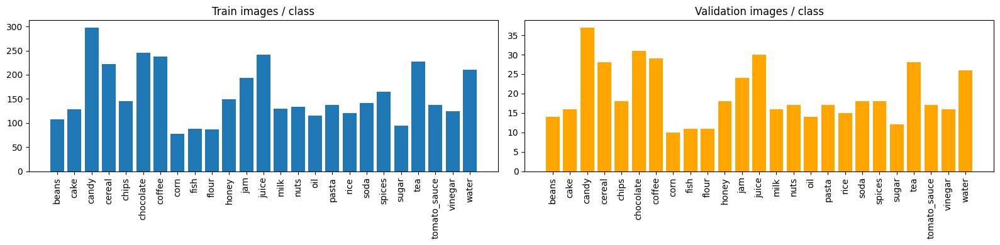
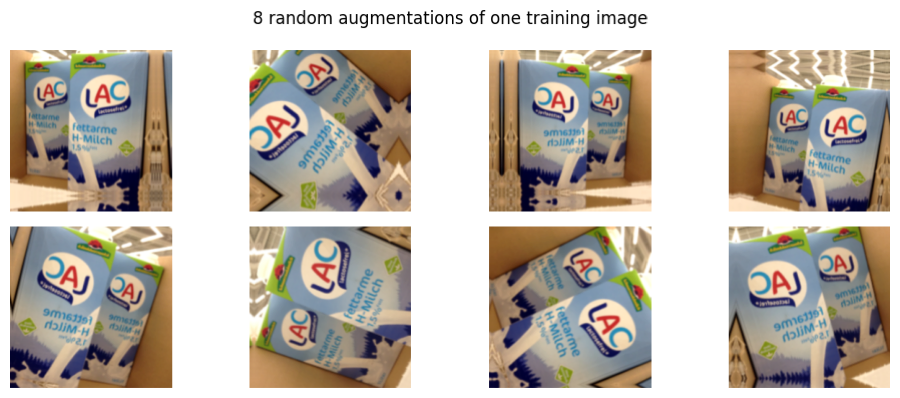
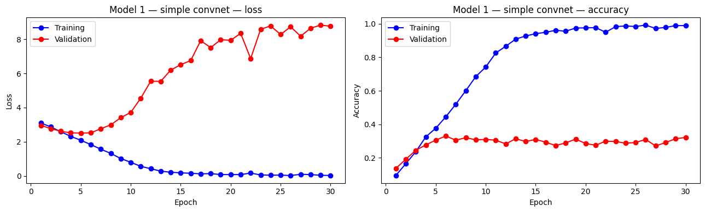
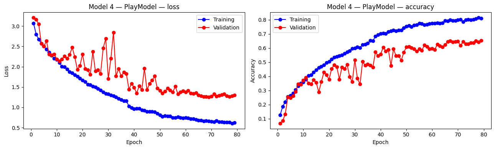
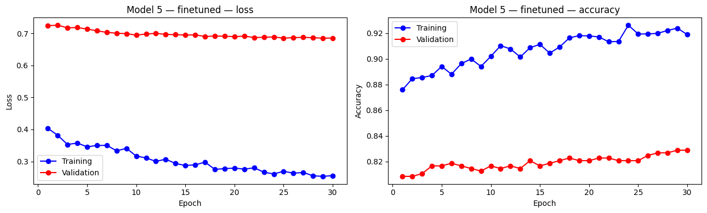
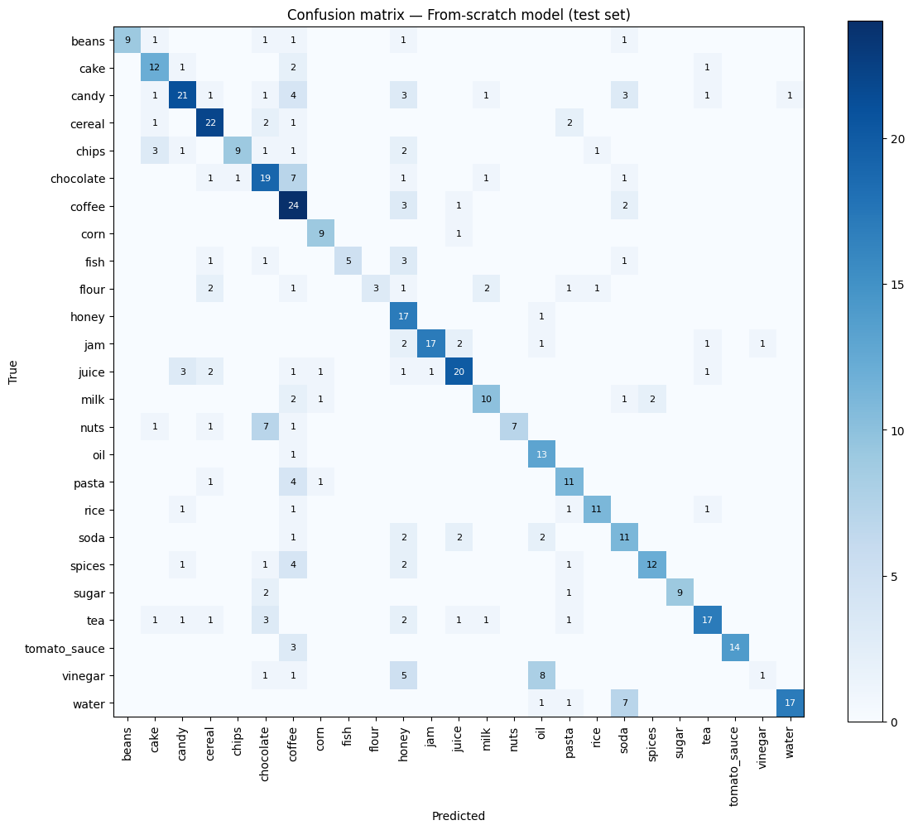
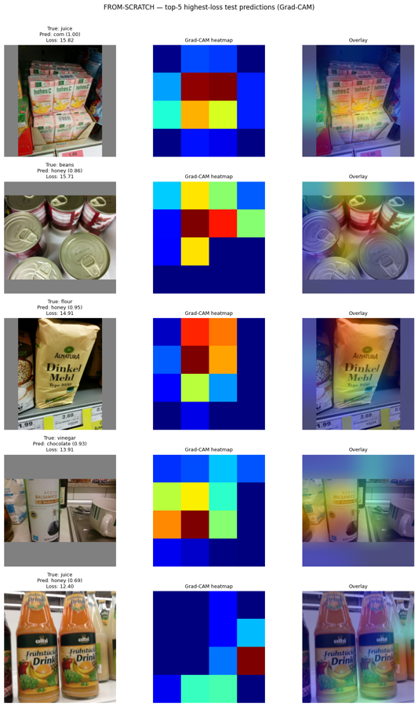

# Grocery Product Classification with CNNs (Freiburg Groceries)

Exam project for the course **ML4BI2** (2026). Author: **Tomáš Kováč**

The task is to classify photos of grocery products into **25 categories** (beans, cake, candy, cereal, … water). Two approaches are compared:

1. **A convnet built from scratch.** It is developed step by step, following Chollet's *Deep Learning with Python*: baseline → augmentation and regularisation → residual connections.
2. **A pretrained EfficientNetV2B0.** The ImageNet weights first stay frozen while a new head is trained, then the top blocks are fine-tuned.

On the held-out test set the fine-tuned EfficientNet reaches **82.2 %** accuracy and the from-scratch CNN reaches **64.6 %**. Random guessing over 25 classes gives about 4 %.

---

## Task

| | |
|---|---|
| Type | Supervised, multi-class, single-label image classification |
| Input | 224 × 224 RGB photo of a grocery product |
| Output | One of 25 product categories |
| Metrics | Categorical accuracy (primary), top-3 accuracy (diagnostic) |
| Random baseline | 1/25 = 4 % |

---

## Data

The data is the exam version of the [Freiburg Groceries Dataset](https://github.com/PhilJd/freiburg_groceries_dataset) (Jund et al., 2016), already split into folders:

| Split | Images | Per class |
|---|---|---|
| `train/` | 3,957 | mean 158, min 77, max 298 |
| `validation/` | 491 | ~20 |
| `test/` (released on exam day) | 495 | mean 19.8, min 10, max 37 |

The images are **not included** in this repository. The notebooks expect them as a zip on Google Drive, which they extract to the local Colab disk.

The classes are noticeably imbalanced. Coffee, candy and cereal have the most images, and this shows up later in the per-class errors.

A **leakage check** hashes every image with MD5 and removes any validation image that is byte-identical to a training image. This exam version contained no such duplicates.

---

## Repository structure

| File | Purpose |
|---|---|
| `EXAM_Part2.ipynb` | Development notebook with all outputs. Covers EDA, the leakage check, the four from-scratch models, the comparison table, validation diagnostics, and EfficientNetV2B0 (frozen, then fine-tuned) |
| `EXAM_Part2_FINAL.ipynb` | Cleaned, unified version of the pipeline, saved without outputs. **Section A** retrains the best from-scratch architecture and the fine-tuned EfficientNet on `train + val` combined. **Section B** loads both checkpoints and evaluates them on `test/` |
| `ML4BI2_EXAM Part1.ipynb` | Exam-day notebook. Loads the two saved models, evaluates them on `test/` and answers the exam questions: confusion matrix, Grad-CAM on the worst predictions, and a new small CNN trained under time pressure |
| `figures/` | Plots exported from the notebooks for this README |

---

## Method

### From scratch: Chollet's three-step climb

| # | Model | What changes | Params |
|---|---|---|---|
| 1 | Simple convnet | 5 × (Conv2D → MaxPool) → Flatten → Dense. No regularisation | 1.6 M |
| 2 | + augmentation + BN | Random flip/rotation/zoom/translation/contrast, BatchNorm, SeparableConv2D, GlobalAveragePooling, Dropout 0.5 | – |
| 3 | Residual (“ResNet-lite”) | 5 residual blocks (32 → 512 filters) with 1×1 projection shortcuts, augmentation, GAP + Dropout | 4.9 M |
| 4 | Improved residual | ResNet stem (7×7 stride 2 + max-pool), post-activation residual blocks with BN, SpatialDropout, lower learning rate | 1.2 M |

Training setup: Adam optimiser, categorical cross-entropy, batch size 32, seed 42. Callbacks: `ModelCheckpoint` (best `val_loss` and best `val_accuracy`), `EarlyStopping` and `ReduceLROnPlateau`. Rescaling and augmentation are layers **inside the model**, so a saved `.keras` file can be evaluated on raw images with no extra preprocessing.

### Pretrained: EfficientNetV2B0

- **Phase 1:** the ImageNet `EfficientNetV2B0` base is frozen. On top sit light augmentation, GlobalAveragePooling, Dropout 0.3 and Dense(25). Learning rate 1e-3, up to 50 epochs. No `Rescaling` layer, because EfficientNetV2 normalises the input internally.
- **Phase 2:** the best Phase-1 checkpoint is reloaded. Blocks `block6f`–`block6h` and `top` are unfrozen, while their BatchNorm layers stay frozen to keep the ImageNet statistics. Learning rate 1e-5, 30 epochs.

---

## Results

### Validation (train/val split, `EXAM_Part2.ipynb`)

| Model | Best epoch | val loss | val accuracy | val top-3 |
|---|---|---|---|---|
| 1. Simple convnet (baseline) | 5 | 2.508 | 30.6 % | 52.1 % |
| 2. + augmentation + BN | 52 | 1.772 | 47.5 % | 74.1 % |
| 3. Residual + augmentation | 39 | 1.490 | 63.1 % | 81.7 % |
| 4. Improved residual | 69 | 1.256 | 64.6 % | 81.5 % |
| 5a. EfficientNetV2B0, frozen | 49 | 0.722 | 80.5 % | 92.9 % |
| **5b. EfficientNetV2B0, fine-tuned** | 29 | **0.685** | **82.9 %** | **93.5 %** |

The baseline overfits almost immediately. Training accuracy approaches 100 % while validation accuracy stalls at about 30 %:

Augmentation, BatchNorm and residual connections close most of that gap:

Fine-tuning the top of EfficientNet adds a further 2–3 percentage points over the frozen base:

### Test set (exam day, `ML4BI2_EXAM Part1.ipynb`)

The final models were retrained on `train + val` combined and then evaluated once on the 495 unseen test images:

| Model | Params | Test loss | **Test accuracy** |
|---|---|---|---|
| From-scratch residual CNN | 4.9 M | 1.715 | **64.6 %** |
| EfficientNetV2B0, fine-tuned | 6.0 M | 0.607 | **82.2 %** |

- **Classified well:** coffee, cereal, candy, juice. These are among the largest training classes.
- **Classified badly:** vinegar (mistaken for oil or honey), flour (mistaken for cereal or milk), fish, nuts. The confused products look alike in colour, shape and bottle type, and the from-scratch model does not pick up the finer texture or label details that tell them apart.

### Grad-CAM: where the model looks when it fails

Grad-CAM was run on the five test images with the highest loss under the from-scratch model:

In every case the model attends to the product itself rather than the background. Its decisions follow dominant colour and shape, though: yellow packaging is read as *corn* or *honey*, and the brown/white contrast on a vinegar bottle is read as *chocolate*. With about 4,000 training images a model trained from scratch cannot learn fine texture cues. This is the main reason the pretrained model wins.

---

## Conclusions

- On a small dataset (~160 images per class), **regularisation decides most of the outcome**. Augmentation alone roughly doubles validation accuracy over the unregularised baseline, and residual connections add another ~15 percentage points.
- **Transfer learning clearly wins:** about +18 percentage points of test accuracy over the best from-scratch model with a similar parameter count. ImageNet features already encode the texture and detail cues that the from-scratch model cannot learn from 4k images.
- The remaining errors are mostly between **look-alike packaging** (vinegar/oil/honey, flour/milk/cereal) and in **under-represented classes**.

---

## How to run

The notebooks were written for **Google Colab** with a GPU (T4 is enough).

1. Upload the dataset zip to Google Drive, then change `ZIP_PATH`, `DRIVE_DIR` and `MODEL_DIR` in the setup cell to match your Drive.
2. Open the notebook in Colab and choose *Runtime → Change runtime type → GPU*.
3. Run `EXAM_Part2_FINAL.ipynb` Section A to train and save both models (about 2.5–3 h on a T4). Then run Section B, or `ML4BI2_EXAM Part1.ipynb`, to evaluate them on `test/`.

Main dependencies: TensorFlow 2.20 (Keras), NumPy, pandas, Matplotlib, scikit-learn, Pillow.

## References

- Chollet, F. (2021). *Deep Learning with Python* (2nd ed.). Manning.
- Jund, P., Abdo, N., Eitel, A., & Burgard, W. (2016). *The Freiburg Groceries Dataset*. arXiv:1611.05799.
- Tan, M., & Le, Q. (2021). *EfficientNetV2: Smaller Models and Faster Training*. ICML.
- Selvaraju, R. R. et al. (2017). *Grad-CAM: Visual Explanations from Deep Networks via Gradient-based Localization*. ICCV.
